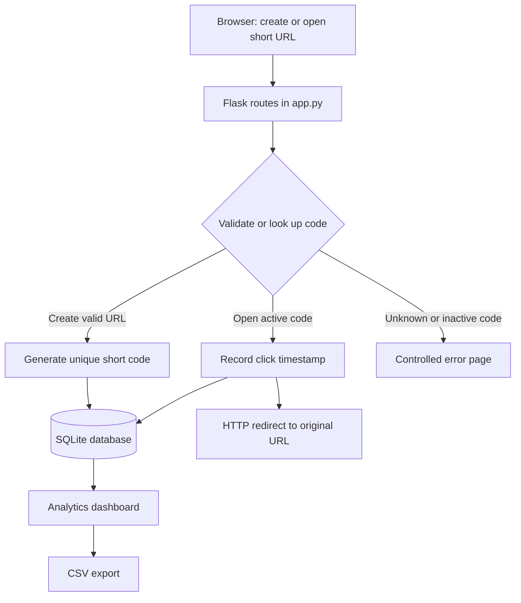

# LinkLite — URL Shortener with Analytics
**Course project:** EF101-P06, Fall 2026  
**Stack:** Python, Flask, SQLite, HTML, CSS

LinkLite converts long `http://` or `https://` URLs into short links, redirects visitors to the original destination, and records click timestamps. It includes a dashboard, link management, seven-day click chart, and CSV export.


## Upload to GitHub
1. Create a new empty repository on GitHub named `EF101-P06-URL-Shortener-Analytics` (do not add a README there, because this folder already has one).
2. Open a terminal in this project folder and run:
   ```bash
   git init
   git add app.py templates static requirements.txt seed_demo.py README.md REPORT.md REPORT.pdf architecture.png .gitignore
   git commit -m "Initial URL shortener with analytics"
   git branch -M main
   git remote add origin https://github.com/YOUR-USERNAME/EF101-P06-URL-Shortener-Analytics.git
   git push -u origin main
   ```
3. Replace `YOUR-USERNAME` with your GitHub username. Keep `url_shortener.db` out of Git; the app creates its own local database.

## Requirements
- Python 3.10 or newer
- pip

## Run on Windows
1. Extract the ZIP and open the `url_shortener_analytics` folder in VS Code or a terminal.
2. Open a terminal in this folder.
3. Create a virtual environment:
   ```powershell
   py -m venv .venv
   .\.venv\Scripts\Activate.ps1
   ```
   If PowerShell blocks activation, use `.\.venv\Scripts\python.exe -m pip install -r requirements.txt` and `.\.venv\Scripts\python.exe app.py`.
4. Install dependencies:
   ```powershell
   python -m pip install -r requirements.txt
   ```
5. Start the application:
   ```powershell
   python app.py
   ```
6. Open **http://127.0.0.1:5000** in a browser. The SQLite database is created automatically.

## Run on macOS/Linux
```bash
python3 -m venv .venv
source .venv/bin/activate
python -m pip install -r requirements.txt
python app.py
```
Then visit http://127.0.0.1:5000.

## Demo data (optional)
To populate 30 clearly labelled demo links and at least 100 simulated click events:
```bash
python seed_demo.py
```
Demo links point to harmless `example.com` addresses. The seed script will not add duplicates if demo records already exist. These are **simulated demonstration records**, not real visitor analytics. You can remove demo links from the dashboard. To start from a completely clean database, stop the app and delete `url_shortener.db`; it will be recreated on the next start.

## Main code segments
- **`app.py` — routes and application logic:** validates URL input, generates unique short codes, saves links, performs redirects, records each successful redirect with a timestamp, supports activation/deactivation and deletion, prepares analytics, and exports CSV.
- **`templates/index.html` — link dashboard:** URL form, summary cards, search/filter controls, link table, and management actions.
- **`templates/analytics.html` — analytics view:** click summary, seven-day bar chart, most-clicked links, and zero-click links.
- **`templates/error.html` — controlled error pages:** missing and deactivated short codes display helpful messages instead of crashing.
- **`static/style.css` — user interface:** responsive layout, cards, tables, buttons, chart styling, and mobile layout.
- **`seed_demo.py` — optional test data:** creates labelled demo records for a project demonstration.

## Architecture / data flow


## Database schema
- **`links`**: `id`, `original_url`, `short_code` (unique), `created_at`, `is_active`, `is_demo`.
- **`clicks`**: `id`, `link_id`, `clicked_at`; each click references a saved link. Deleting a link also deletes its click history.

## Tests to demonstrate
1. Create a valid URL such as `https://example.com/hello`.
2. Try a blank value, `ftp://example.com`, or malformed URL and verify validation feedback.
3. Open a created short link twice; its click count should increase by two.
4. Restart the app and verify saved links and click counts remain.
5. Try a random code and a deactivated code; verify controlled 404 and 410 pages.
6. Create several links and check the search and status filters.
7. Export CSV and open it in Excel.
8. Run `python seed_demo.py` to demonstrate 30 stored links and 100+ click events. The generated clicks are artificial and labelled as demo data.

## Responsible use and limitations
- This classroom demonstration does not disguise malicious destinations and does not collect IP addresses or personal browsing details.
- This is intended for local classroom use, not as a production public URL-shortening service. A public deployment should add authentication, abuse reporting, rate limiting, HTTPS, stronger secret management, and operational monitoring.
- Short links use random six-character codes; collision checks are performed before insert. SQLite and click timestamps are stored locally.
